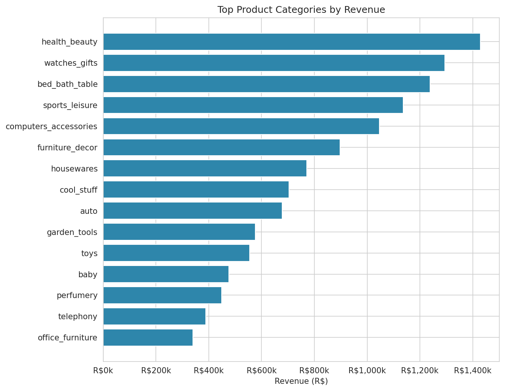
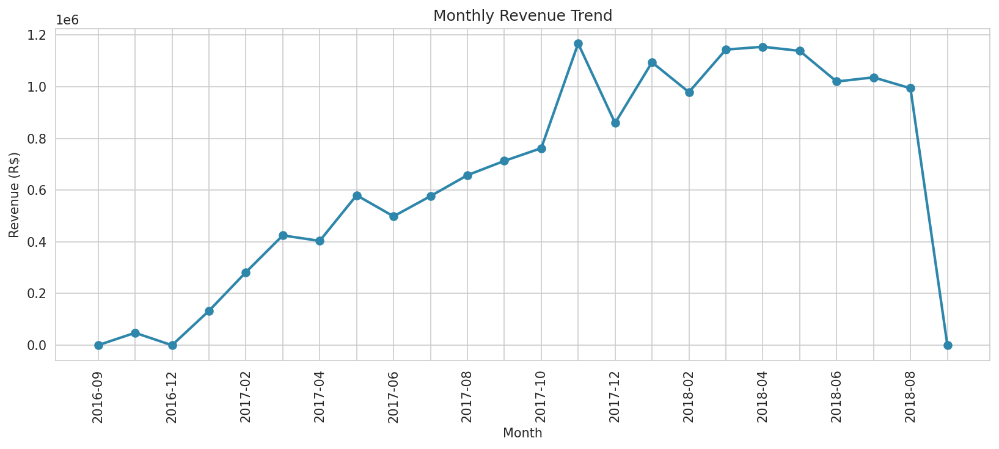
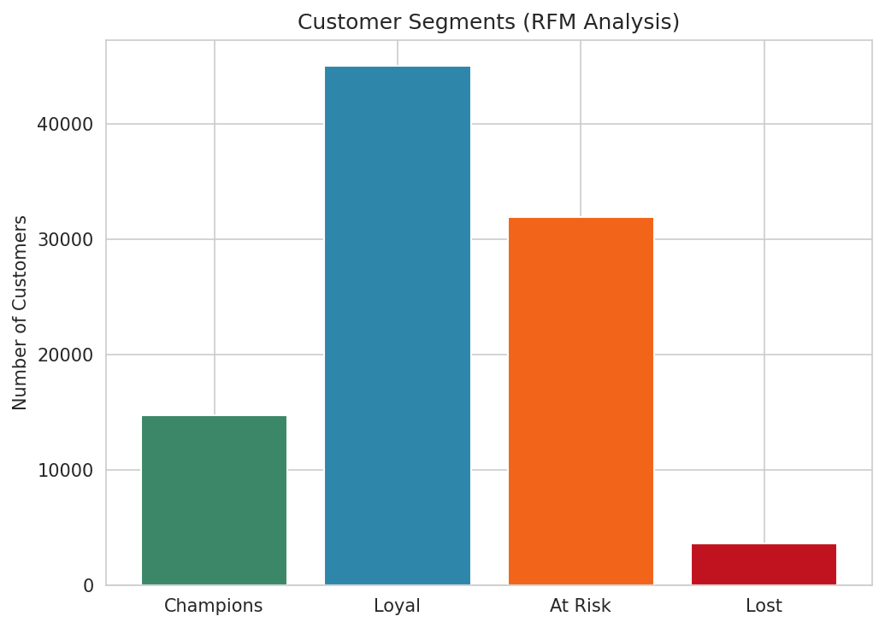
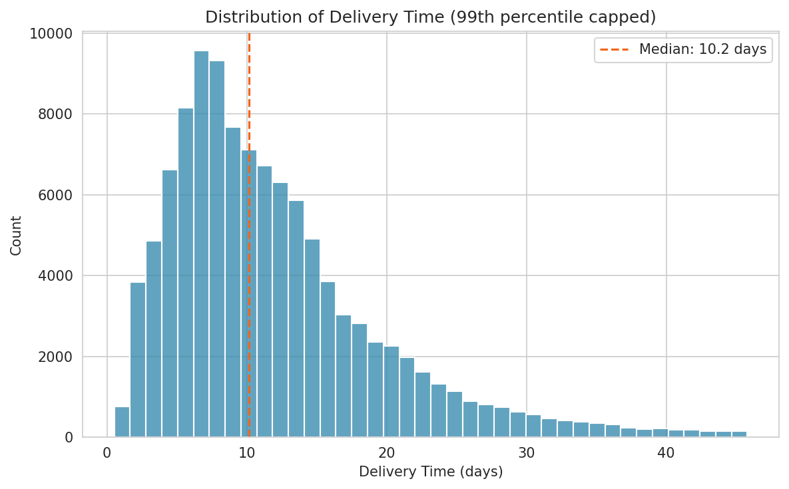

# Olist Brazilian E-Commerce Analytics

A modular, production-style Python pipeline that turns the nine raw
[Olist Brazilian E-Commerce](https://www.kaggle.com/datasets/olistbr/brazilian-ecommerce)
CSVs into a cleaned, feature-engineered analytical dataset, a set of
static and interactive charts, and a filterable Streamlit dashboard.

The project is deliberately organized as a **pipeline of single-purpose
modules** (load → clean → merge → engineer features → analyze → visualize)
rather than one long notebook. Each stage takes the previous stage's
output and does exactly one job, which makes the code testable, easy to
re-run partially, and easy to reason about.

## Key findings

Numbers below are computed by the pipeline itself (`outputs/reports/eda_summary.json`)
over the full 2016–2018 dataset, so they'll update automatically on re-run:

| Metric | Value |
|---|---|
| Total orders | 98,666 |
| Total revenue | R$ 15.67M |
| Average order value | R$ 160.08 |
| Average review score | 4.03 / 5 |
| Average delivery time | 12.5 days |
| Late delivery rate | 7.9% |
| Unique customers | 95,420 |
| Unique sellers | 3,095 |

`health_beauty`, `watches_gifts`, and `bed_bath_table` are the top three
categories by revenue; São Paulo state (`SP`) alone accounts for roughly
37% of total revenue. See `outputs/figures/` for the full chart set.






## Project structure

```
olist-ecommerce-analytics/
├── config.py                  # Central paths, palette, and domain constants
├── main.py                    # CLI entry point: runs the full pipeline end to end
├── requirements.txt
├── LICENSE
│
├── data/
│   └── raw/                   # Place the 9 Olist CSVs here (not checked into git)
│
├── src/
│   ├── data_loader.py         # Read raw CSVs, validate schema
│   ├── data_cleaner.py        # Per-table cleaning: dtypes, dedup, missing values
│   ├── data_merger.py         # Join cleaned tables into one order-item-grain dataset
│   ├── feature_engineering.py # Delivery metrics, RFM, geo-distance, financial ratios
│   ├── eda.py                 # Descriptive stats & summary tables (KPIs, trends)
│   └── visualization.py       # matplotlib/seaborn PNGs + Plotly interactive HTML
│
├── dashboard/
│   └── app.py                 # Streamlit dashboard (filters + 5 analysis tabs)
│
├── tests/
│   └── test_pipeline.py       # Unit tests for cleaning & feature-engineering logic
│
└── outputs/
    ├── processed/              # olist_master_dataset.parquet / .csv (generated)
    ├── figures/
    │   ├── static/              # PNG charts for READMEs / reports
    │   └── interactive/         # Standalone Plotly HTML charts
    └── reports/
        └── eda_summary.json     # Machine-readable KPI snapshot
```

Each module builds strictly on the previous one's *output*, not its
internals — `data_merger.py` never re-implements cleaning logic, `eda.py`
never re-merges tables, and the Streamlit dashboard calls the exact same
`src.eda` / `src.visualization` functions the batch pipeline does, so the
dashboard and the static report can never silently disagree.

## Dataset

This project uses the **Brazilian E-Commerce Public Dataset by Olist**
(~100k orders from 2016–2018, across 9 relational CSVs: orders, order
items, payments, reviews, products, customers, sellers, geolocation, and
a category-name translation table). Download it from
[Kaggle](https://www.kaggle.com/datasets/olistbr/brazilian-ecommerce) and
place the 9 CSV files in `data/raw/`.

## Setup

```bash
# 1. Clone and enter the project
git clone https://github.com/waseemalali/olist-ecommerce-analytics.git
cd olist-ecommerce-analytics

# 2. Create a virtual environment (recommended)
python3 -m venv .venv
source .venv/bin/activate      # Windows: .venv\Scripts\activate

# 3. Install dependencies
pip install -r requirements.txt

# 4. Add the raw data
#    Download the 9 CSVs from Kaggle and place them in data/raw/
```

## Usage

**Run the full pipeline** (loads, cleans, merges, engineers features, runs
EDA, generates all charts, and saves the master dataset):

```bash
python main.py
```

Use `--skip-charts` for a faster data-only re-run:

```bash
python main.py --skip-charts
```

**Launch the interactive dashboard** (requires `outputs/processed/olist_master_dataset.parquet`
to exist, i.e. run `main.py` at least once first):

```bash
streamlit run dashboard/app.py
```

The dashboard provides:
- Sidebar filters for date range, customer state, and product category
- KPI summary cards that recompute live from the filtered slice
- **Overview** — revenue trend, top categories, revenue by state
- **Delivery Performance** — delivery-time distribution, late-delivery rate, top sellers
- **Customer Segments** — RFM (Recency/Frequency/Monetary) segmentation scatter plot
- **Reviews** — review-score distribution and sentiment breakdown
- **Geography** — a scatter map of customer locations

**Run the test suite:**

```bash
pytest tests/ -v
```

## Design notes

- **Grain choice**: the master dataset is kept at order-*item* grain (one
  row per line item), since that's the finest grain any table offers.
  Order-level or customer-level views are produced with a `groupby` on
  demand rather than baked in, so no information is lost by pre-aggregating.
- **Revenue and delivery-time metrics exclude non-delivered orders**
  (canceled, unavailable, created, invoiced) — a canceled order has no
  real delivery experience or realized revenue to measure. This is defined
  once in `config.NON_DELIVERED_STATUSES` and reused everywhere.
- **RFM segmentation** is computed at the `customer_unique_id` grain (the
  stable person behind possibly-many `customer_id` records) using each
  customer's distinct orders, so a five-item order doesn't inflate
  frequency relative to a one-item order.
- **Geolocation deduplication**: the raw geolocation table has ~1M rows
  but only ~19k unique zip-code prefixes; it's collapsed to one
  representative lat/lng per zip before being joined, rather than exploding
  the join.
- **Missing values are handled explicitly per case**, not blanket-filled:
  missing delivery dates on undelivered orders are left as `NaT` (they're
  informative, not a defect), while missing product categories/dimensions
  are imputed since the row's other data (price, order info) is still valid.

## Tech stack

Python 3.10+ · pandas · numpy · matplotlib · seaborn · plotly · streamlit · pytest

## Author

**Waseem Mahmoud** · [LinkedIn](https://www.linkedin.com/in/waseem-mahmoud-a34154213) · [GitHub](https://github.com/waseemalali)

## License

MIT — see [LICENSE](LICENSE).
